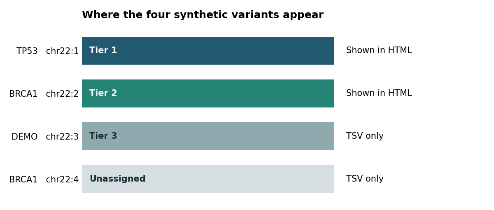
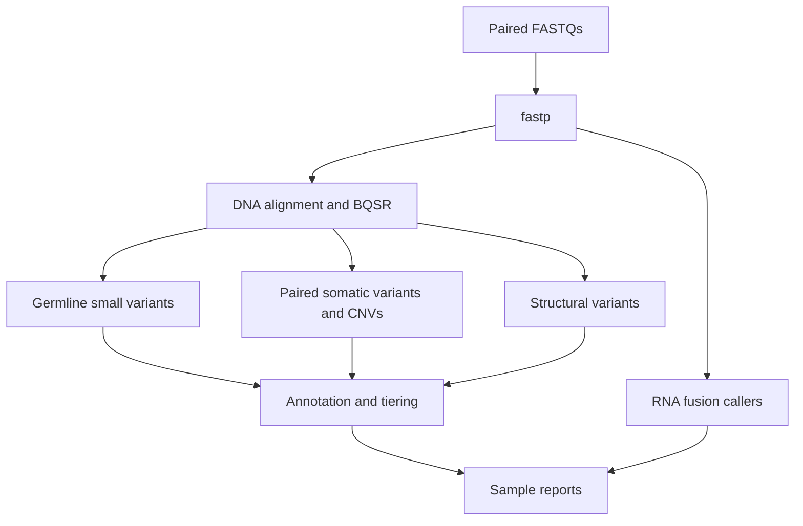

# ClinVarFlow

ClinVarFlow is a Nextflow DSL2 project for research analysis of human GRCh38 DNA and RNA sequencing. Normal DNA can enter germline calling; matched tumour–normal pairs enter somatic and copy-number analysis; RNA enters fusion calling. The HTML report keeps the sample identity and evidence from each selected branch together.

## Start here: reproduce the variant report

The first run answers a specific question: **given an annotated DNA variant file and two RNA fusion call tables, which records appear in the sample report, and why?** The tutorial starts after variant calling. It uses four invented DNA records and one invented fusion pair. A separate section below starts from paired sequencing reads.

### 1. Open the project and install the demo requirements

Open a Linux or WSL Bash terminal. Clone the repository and enter the folder containing `main.nf`:

```bash
git clone https://github.com/anjalianjali1234/ClinVarFlow.git
cd ClinVarFlow
```

If you downloaded the ZIP, extract it and open a terminal in that folder. Have Python 3.11 or 3.12 with the venv module available. The first installation requires internet access. The following Python walkthrough can then run offline, without a genome download, container engine or Nextflow installation.

```bash
python3 -m venv .venv
source .venv/bin/activate
python -m pip install -r requirements-test.txt
python -m pytest -q tests
```

The optional PostgreSQL integration test can skip when no test database is configured. Keep the environment active and run the following blocks in the same terminal.

### 2. Generate the example inputs

```bash
RUN=results/tutorial
mkdir -p "$RUN/evidence"
python tests/fixtures.py "$RUN/input"
head -n 5 "$RUN/input/demo.vcf"
```

The generator writes a VCF (a table of variant calls) with VEP annotations for sample `DEMO`, plus `arriba.tsv` and `sf.tsv` for two RNA fusion callers. The empty `known.tsv` supplies an empty list of known gene pairs. Gene names, coordinates and clinical labels in this fixture are illustrative and have no patient interpretation.

### 3. Prioritize the DNA variants

```bash
python bin/tier_variants.py --vcf "$RUN/input/demo.vcf" \
  --genes assets/cancer_genes.txt --sample DEMO --out "$RUN/evidence/demo.tiers.tsv"
cat "$RUN/evidence/demo.tiers.tsv"
```

**Expected result:** four data rows. Each has depth 20 and variant allele fraction 0.40: eight of the twenty allele-supporting reads carry the alternate base. The project assigns research priorities from the annotations.

| Synthetic record | Evidence supplied | Output |
|---|---|---|
| TP53, chr22:1 | Fixture supplies a Pathogenic label without conflicting evidence | Tier 1 |
| BRCA1, chr22:2 | HIGH impact, gene on project panel, population frequency 0.0002 | Tier 2 |
| DEMO, chr22:3 | Coding synonymous change, population frequency 0.005 | Tier 3 |
| BRCA1, chr22:4 | HIGH impact, population frequency missing | Blank tier; frequency stays unknown |



The TSV retains all four records. The HTML variant table displays the two highest-priority records. These project tiers support research review. [Inspect the complete evidence table](docs/example/evidence/demo.tiers.tsv).

### 4. Combine RNA fusion evidence

```bash
python bin/fusion_consensus.py "$RUN/input/arriba.tsv" "$RUN/input/known.tsv" \
  "$RUN/evidence/demo.fusions.tsv" --star "$RUN/input/sf.tsv"
cat "$RUN/evidence/demo.fusions.tsv"
```

Expect one directional pair, **DEMO1 → DEMO2**, with supporting callers `arriba,starfusion`. The row retains Arriba's original `low` confidence label. Agreement on partner order is enough for this consensus rule. [Inspect the fusion result](docs/example/evidence/demo.fusions.tsv).

### 5. Render the HTML and verify the outputs

```bash
python bin/make_report.py "$RUN/evidence" DEMO assets/report.html.j2 "$RUN/demo.report.html"
diff -r docs/example/evidence "$RUN/evidence"
```

Open **results/tutorial/demo.report.html** in a browser. Check the sample name, two prioritized DNA rows and one fusion pair. A silent `diff` with exit status zero means your evidence files match the bundled results exactly. To inspect the output before running the tutorial, open [the saved report](docs/example/demo.report.html) from the extracted folder.

### 6. Repeat the example through Nextflow

With Java 17+, Nextflow 24.10.4 and the Python environment from step 1 active, run:

```bash
nextflow run . -profile test --outdir results/demo
diff -r docs/example/evidence results/demo/evidence
```

Open `results/demo/demo.report.html`. The test profile automates the same fixture generation, DNA prioritization, fusion consensus and report rendering. It exercises the reporting path. Sensitivity and precision require independently characterized samples and callable regions. [Benchmark record and reproduction protocol](docs/benchmarks.md).

## Run sequencing data

1. Prepare the external reference directory and the resources for your chosen branches. See [reference files](docs/reference.md).
2. Copy [the example samplesheet](assets/samplesheet_example.csv) and replace its paths with your paired FASTQs. Repeated rows for a sample represent separate lanes.
3. Install Conda and run the command below. To use Docker, build the images with `bash docker/build.sh`, then use `-profile docker`.

```bash
nextflow run . -profile conda -resume \
  --input samples.csv --reference /data/cvf/grch38 --assay wes \
  --tools germline,somatic,cnv,sv,fusion --outdir results/cohort
```



| Branch | Input | Outputs |
|---|---|---|
| Germline | Normal DNA | HaplotypeCaller gVCF, normalized PASS VCF, BCFtools statistics |
| Somatic | Tumour with one matched normal | Mutect2 calls filtered with orientation and contamination estimates |
| Copy number | Matched DNA pair | CNVkit segments, plots, gene metrics, VCF and AnnotSV table |
| Structural variants | Normal DNA or matched pair | Manta and Delly calls, SURVIVOR consensus and AnnotSV table |
| Fusion | Paired RNA | Arriba and STAR-Fusion evidence, directional consensus TSV |
| Reporting | Branch outputs | VEP annotation, project tiers, per-sample offline HTML and MultiQC |

[Parameters and database queries](docs/usage.md) · [Outputs](docs/output.md) · [Benchmark status](docs/benchmarks.md) · [Build specification](docs/build-specification.pdf) · [Tool references](docs/tools.md)

Research use only. Project tiers prioritize variants for inspection. Clinical interpretation requires separate evidence assessment.

## Copyright

Copyright (c) 2026 ClinVarFlow contributors. All rights reserved. Contact the repository owner for permission to reuse the original project material.
